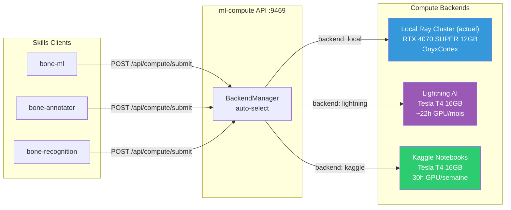
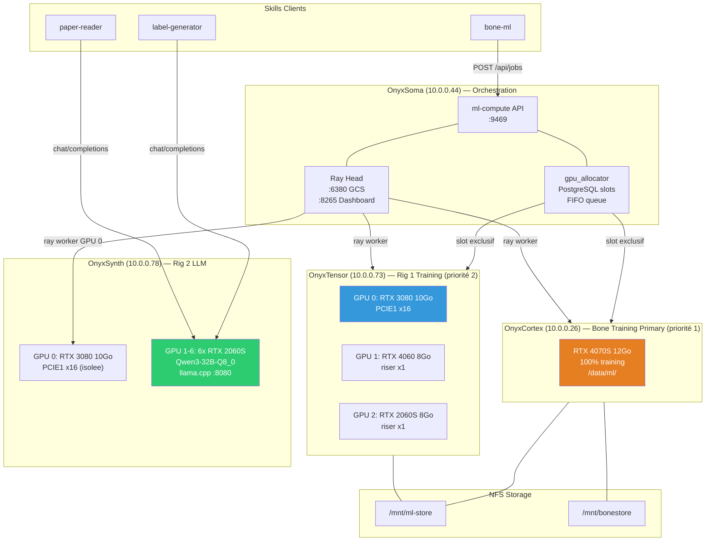
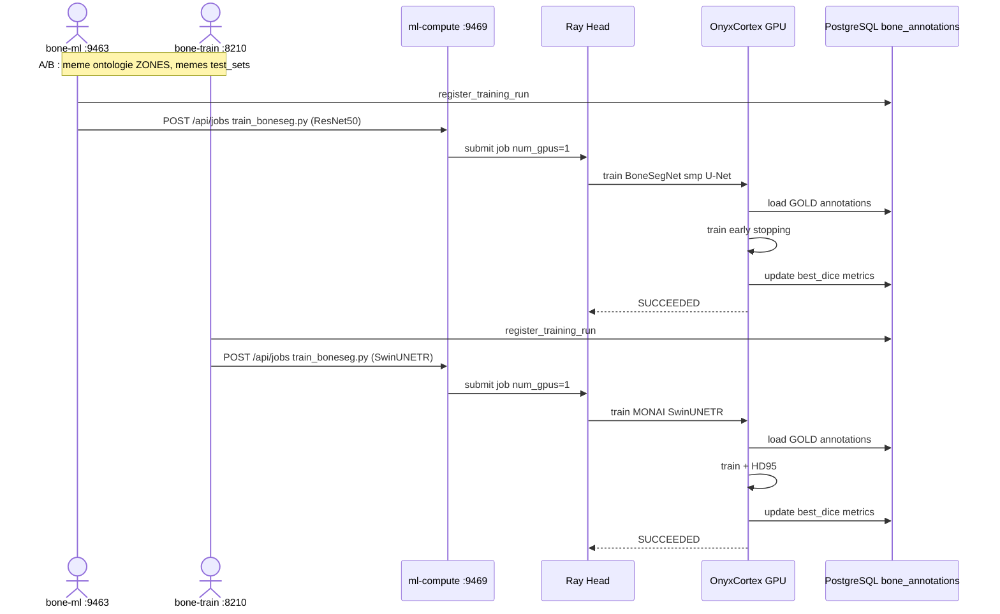
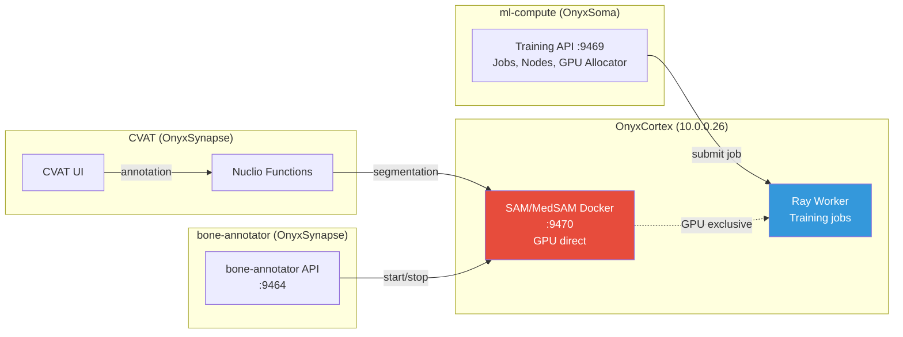
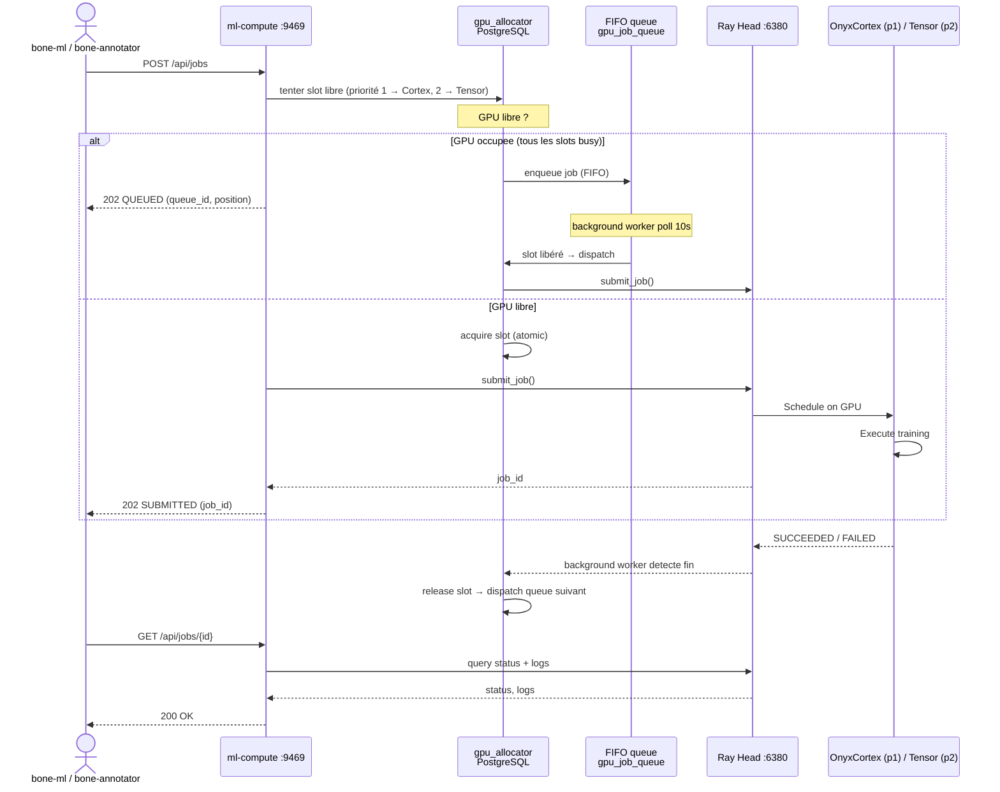
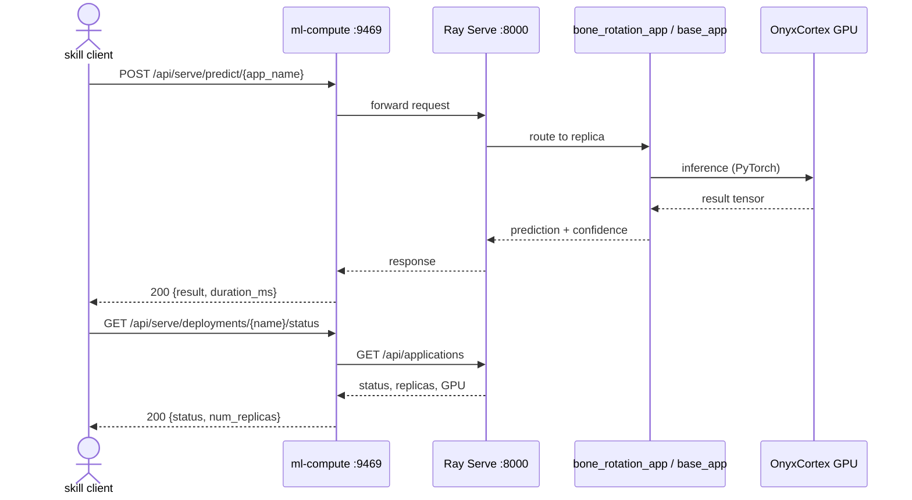
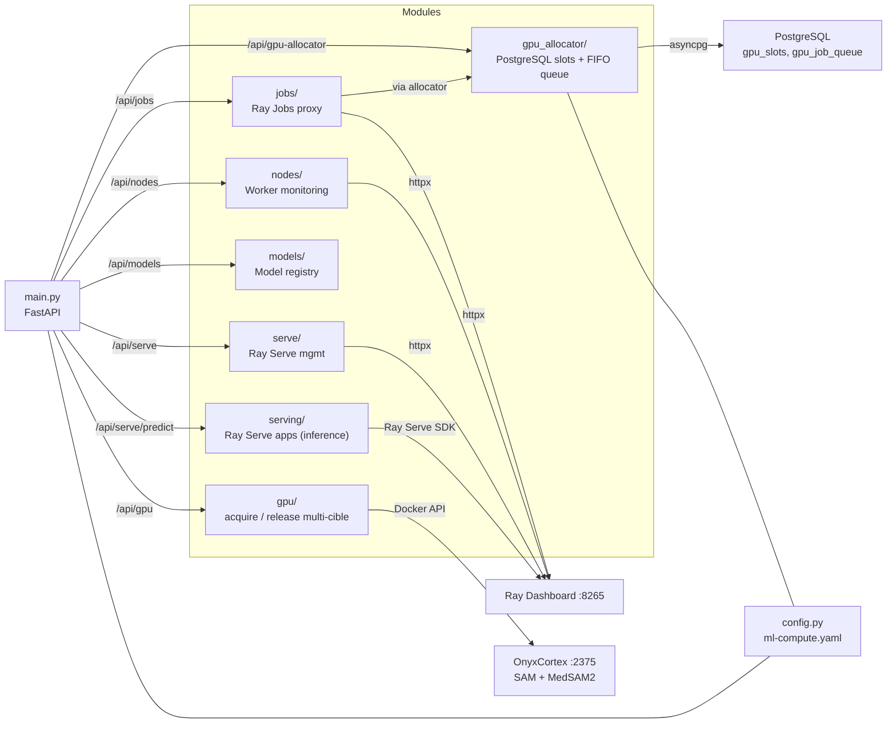

# ml-compute - Architecture Diagram

## Multi-Backend Compute

---

## Cluster Ray + Rigs GPU

## BoneSeg Training Flow (A/B)

## Separation SAM / ml-compute

**Point cle** : SAM et Ray Worker partagent le meme GPU sur OnyxCortex.
L'API `POST /api/gpu/acquire` stoppe SAM et MedSAM2 avant un training, puis
`POST /api/gpu/release` les relance.

**Protocole CVAT** : Nuclio appelle `POST http://10.0.0.26:9470/api/embed` qui doit
retourner `{blob, shape}` (image `sam-inference`, gere par bone-annotator).

## Job Submission Flow

## Ray Serve Inference Flow

## Module Interactions

